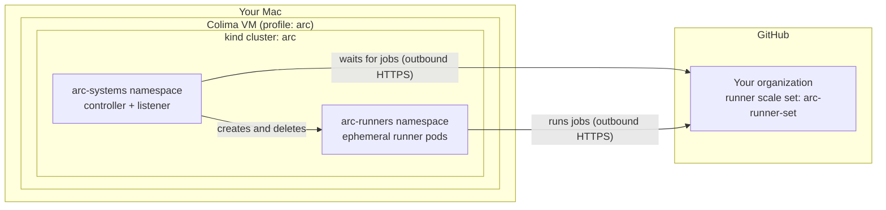

# Actions Runner Controller on kind (macOS + Colima)

This guide sets up [Actions Runner Controller (ARC)](https://docs.github.com/en/actions/concepts/runners/actions-runner-controller) on a local Kubernetes cluster created with [kind](https://kind.sigs.k8s.io/) (Kubernetes in Docker) on macOS, using [Colima](https://github.com/abiosoft/colima) as the Docker engine.
When you finish, jobs from your GitHub organization run in short-lived runner pods on your Mac.

Each step gives you commands to copy and paste into your terminal, and Step 6 also has a few clicks in your browser.
Run the steps in order, in the same terminal window.

- [Before you start](#before-you-start)
- [Step 1: Install the tools](#step-1-install-the-tools)
- [Step 2: Set variables](#step-2-set-variables)
- [Step 3: Start a Colima VM](#step-3-start-a-colima-vm)
- [Step 4: Create a kind cluster](#step-4-create-a-kind-cluster)
- [Step 5: Install the ARC controller](#step-5-install-the-arc-controller)
- [Step 6: Create a GitHub App](#step-6-create-a-github-app)
- [Step 7: Store the GitHub App credentials in the cluster](#step-7-store-the-github-app-credentials-in-the-cluster)
- [Step 8: Install a runner scale set](#step-8-install-a-runner-scale-set)
- [Step 9: Run a test workflow](#step-9-run-a-test-workflow)
- [Step 10 (optional): Enable Docker-in-Docker](#step-10-optional-enable-docker-in-docker)
- [Stop, resume, and change settings](#stop-resume-and-change-settings)
- [Troubleshooting](#troubleshooting)
- [Clean up](#clean-up)
- [References](#references)

## Before you start

### What you'll build



- ARC talks to GitHub over outbound HTTPS only. You don't open any ports or configure webhooks.
- The **listener** pod keeps a long-poll connection to GitHub and tells the **controller** how many runners the queued jobs need.
- The controller creates one **ephemeral runner pod** per job and deletes it when the job finishes.

This guide uses these names:

| Thing | Name |
| --- | --- |
| Colima profile (VM) | `arc` |
| Docker context (used by kind) | `colima-arc` |
| kind cluster / kubectl context | `arc` / `kind-arc` |
| kubeconfig file | `~/arc-kind/kubeconfig` |
| ARC controller (Helm release / namespace) | `arc` / `arc-systems` |
| Runner scale set (Helm release / namespace) | `arc-runner-set` / `arc-runners` |
| Kubernetes secret with the GitHub App credentials | `arc-github-app` |
| GitHub App | `arc-kind-<your-org>` |
| Demo repository (private) | `<your-org>/arc-kind-demo` |
| Working directory on your Mac | `~/arc-kind` |

### Tested with

| Component | Version |
| --- | --- |
| macOS | 27.2 on Apple silicon |
| Colima | 0.10.3 |
| Docker CLI | 29.9.3 |
| kind | 0.33.0 (node image `kindest/node:v1.37.0`) |
| kubectl | 1.37.2 |
| Helm | 4.3.1 |
| GitHub CLI | 2.103.3 |
| ARC Helm charts | 0.15.1 |
| GitHub Actions runner | 2.338.2 |

### Prerequisites

- A Mac with [Homebrew](https://brew.sh/).
- A GitHub organization where you're an **owner**. You need this to create a GitHub App for the organization and to manage its runners.
  If the organization belongs to an enterprise, the enterprise policies must allow self-hosted runners.
- About 4 CPU cores, 8 GiB of memory, and 60 GiB of disk that you can give to a VM.

> [!NOTE]
> The code blocks contain no comments, so they paste cleanly into zsh (the macOS default shell) and bash.
> Paste one block at a time, and wait for it to finish before you paste the next.
> If you open a new terminal window partway through, run [Step 2](#step-2-set-variables) again first.

> [!WARNING]
> Self-hosted runners run your workflows' code on your Mac.
> This guide registers the runners for private repositories only.
> Don't make them available to public repositories: anyone who can open a pull request could run code on your machine.

## Step 1: Install the tools

Install Colima, the Docker CLI, kind, kubectl, Helm, and the GitHub CLI.
If a tool is already installed, Homebrew upgrades it to the latest version.

```bash
brew install colima docker kind kubectl helm gh
```

Check that each tool runs:

```bash
colima version
docker --version
kind version
kubectl version --client
helm version
gh --version
```

Check that the GitHub CLI is signed in:

```bash
gh auth status
```

If it says you aren't logged in, sign in and follow the prompts:

```bash
gh auth login
```

## Step 2: Set variables

Replace `your-org` with your organization's name, the part after `github.com/` in its URL.
Then paste the block.

```bash
export GITHUB_ORG="your-org"
export ARC_VERSION="0.15.1"
export KUBECONFIG="$HOME/arc-kind/kubeconfig"
mkdir -p "$HOME/arc-kind"
```

- `ARC_VERSION` pins the version of the ARC Helm charts.
  To use a newer version, look for the latest `gha-runner-scale-set-x.y.z` release on the [ARC releases page](https://github.com/actions/actions-runner-controller/releases).
- `KUBECONFIG` keeps the cluster's credentials in a separate file.
  `kubectl` and `helm` in this terminal use the cluster that you create in Step 4, and your default kubeconfig (`~/.kube/config`) stays as it is.

## Step 3: Start a Colima VM

Create and start a Colima VM in a separate profile named `arc`.
A separate profile keeps the cluster away from your other containers, and you can delete it in one command when you're done.

```bash
colima start --profile arc --cpus 4 --memory 8 --disk 60 --activate=false
```

Colima may print `failed to set up forwarding tcp port 53 (negligible if already forwarded)`.
As the message says, you can ignore it.

Colima creates a Docker context named `colima-arc` for the VM.
`--activate=false` keeps your current default Docker context, so other tools that use Docker aren't affected.
This guide selects `colima-arc` only for the `kind` commands.

Check the VM and the context:

```bash
colima list
docker context ls
```

You should see the `arc` profile as `Running` with 4 CPUs and 8 GiB of memory, and a context named `colima-arc`.

Raise the inotify instance limit in the VM.
The default (128) is too low for kind and can cause `too many open files` errors in pods.
The setting is saved in the VM, so it survives restarts.

```bash
colima ssh --profile arc -- sudo sh -c 'echo fs.inotify.max_user_instances=512 > /etc/sysctl.d/99-kind.conf && sysctl -p /etc/sysctl.d/99-kind.conf' < /dev/null
```

You should see `fs.inotify.max_user_instances = 512`.
(The `< /dev/null` stops `colima ssh` from reading the rest of your paste as input.)

## Step 4: Create a kind cluster

Create a single-node cluster named `arc` in the Colima VM.
`DOCKER_CONTEXT=colima-arc` tells kind which Docker engine to use.
The first run downloads the node image, which takes a few minutes.

```bash
DOCKER_CONTEXT=colima-arc kind create cluster --name arc --wait 5m
```

kind writes the cluster's credentials to `~/arc-kind/kubeconfig` (the `KUBECONFIG` file) and selects the `kind-arc` context in it.
Check the node:

```bash
kubectl get nodes
```

You should see one node in the `Ready` state:

```text
NAME                STATUS   ROLES           AGE   VERSION
arc-control-plane   Ready    control-plane   1m    v1.37.0
```

## Step 5: Install the ARC controller

Install the ARC controller (the `gha-runner-scale-set-controller` Helm chart) into the `arc-systems` namespace.
This also installs ARC's custom resource definitions.

```bash
helm install arc \
  --namespace arc-systems \
  --create-namespace \
  --version "$ARC_VERSION" \
  oci://ghcr.io/actions/actions-runner-controller-charts/gha-runner-scale-set-controller
```

Wait for the controller to start, then check its pod:

```bash
kubectl wait --namespace arc-systems --for=condition=Available deployment --all --timeout=5m
kubectl get pods --namespace arc-systems
```

You should see one controller pod in the `Running` state:

```text
NAME                                     READY   STATUS    RESTARTS   AGE
arc-gha-rs-controller-6b8c9d7f5d-x2x7k   1/1     Running   0          1m
```

## Step 6: Create a GitHub App

ARC needs credentials to register runners in your organization.
GitHub recommends a GitHub App owned by the organization: it isn't tied to a person, and it gets only the permission ARC needs.

You'll collect three things in this step: the **App ID**, a **private key** file, and the **installation ID**.

1. Open the GitHub App registration page for your organization.
   The URL fills in the name, the homepage URL, and the permission for you.

   ```bash
   open "https://github.com/organizations/${GITHUB_ORG}/settings/apps/new?name=arc-kind-${GITHUB_ORG}&description=Actions%20Runner%20Controller%20on%20a%20local%20kind%20cluster&url=https%3A%2F%2Fgithub.com%2Factions%2Factions-runner-controller&public=false&webhook_active=false&organization_self_hosted_runners=write"
   ```

2. Check these fields on the page:
   - **GitHub App name** is `arc-kind-<your-org>`.
     App names are unique across GitHub, so if the name is taken, change it.
   - **Webhook** > **Active** is cleared.
   - **Permissions** > **Organization permissions** > **Self-hosted runners** is **Read and write**.
     ARC needs no other permissions.
   - **Where can this GitHub App be installed?** is **Only on this account**.
3. Click **Create GitHub App**.
4. **App ID:** on the page that opens, copy the number next to **App ID**.
5. **Private key:** scroll down to **Private keys** and click **Generate a private key**.
   Your browser downloads a file named like `arc-kind-<your-org>.<date>.private-key.pem` to `~/Downloads`.
6. In the left sidebar, click **Install App**, then click **Install** next to your organization.
   Select **All repositories** and click **Install**.
   The app has no repository permissions besides read-only metadata, so this doesn't give it access to your code.
7. **Installation ID:** after the installation, your browser shows a URL like `https://github.com/organizations/<your-org>/settings/installations/12345678`.
   Copy the number at the end.

## Step 7: Store the GitHub App credentials in the cluster

Replace the two numbers with your **App ID** and **installation ID** from Step 6.
Then paste the block.

```bash
export GITHUB_APP_ID="123456"
export GITHUB_APP_INSTALLATION_ID="12345678"
```

Move the private key out of `~/Downloads` into the working directory, and make it readable only by you.
The first command picks the newest `*.private-key.pem` file in `~/Downloads`.
If macOS asks whether your terminal app can access the Downloads folder, allow it.

```bash
mv "$(ls -t "$HOME"/Downloads/*.private-key.pem | head -n 1)" "$HOME/arc-kind/github-app.private-key.pem"
chmod 600 "$HOME/arc-kind/github-app.private-key.pem"
```

Create the namespace for the runners and a secret that holds the three credentials.
ARC reads the secret from the same namespace as the runner scale set.

```bash
kubectl create namespace arc-runners
kubectl create secret generic arc-github-app \
  --namespace arc-runners \
  --from-literal=github_app_id="$GITHUB_APP_ID" \
  --from-literal=github_app_installation_id="$GITHUB_APP_INSTALLATION_ID" \
  --from-file=github_app_private_key="$HOME/arc-kind/github-app.private-key.pem"
```

Check that the secret has all three keys:

```bash
kubectl describe secret arc-github-app --namespace arc-runners
```

You should see `github_app_id`, `github_app_installation_id`, and `github_app_private_key` under `Data`.

## Step 8: Install a runner scale set

A runner scale set is a group of runners that ARC creates on demand.
Write its Helm values to a file.
`minRunners: 0` means no runner pods exist until a job arrives, and `maxRunners: 3` caps how many jobs run at once.

```bash
cat > "$HOME/arc-kind/arc-runner-set.yaml" <<EOF
githubConfigUrl: "https://github.com/${GITHUB_ORG}"
githubConfigSecret: arc-github-app
minRunners: 0
maxRunners: 3
EOF
cat "$HOME/arc-kind/arc-runner-set.yaml"
```

Install the runner scale set into the `arc-runners` namespace.
The Helm release name, `arc-runner-set`, becomes the scale set's name in GitHub, and workflows use it in `runs-on`.

```bash
helm install arc-runner-set \
  --namespace arc-runners \
  --version "$ARC_VERSION" \
  --values "$HOME/arc-kind/arc-runner-set.yaml" \
  oci://ghcr.io/actions/actions-runner-controller-charts/gha-runner-scale-set
```

Wait until ARC has registered the scale set with GitHub and started its listener, then check the pods:

```bash
kubectl wait --namespace arc-runners --for=jsonpath='{.status.phase}'=Running autoscalingrunnerset/arc-runner-set --timeout=5m
kubectl get pods --namespace arc-systems
```

The scale set's phase becomes `Running` only after ARC has registered the scale set in your organization's **Default** runner group.
You should see the controller pod and a listener pod for `arc-runner-set`:

```text
NAME                                     READY   STATUS    RESTARTS   AGE
arc-gha-rs-controller-6b8c9d7f5d-x2x7k   1/1     Running   0          5m
arc-runner-set-754b578d-listener         1/1     Running   0          20s
```

If the wait times out, see [The listener pod doesn't appear](#the-listener-pod-doesnt-appear).

## Step 9: Run a test workflow

Create a private demo repository in your organization.
By default, the organization's **Default** runner group doesn't serve public repositories, so the demo repository must be private.

```bash
gh repo create "${GITHUB_ORG}/arc-kind-demo" --private --add-readme
```

Write a workflow that runs on `arc-runner-set`, and add it to the demo repository through the GitHub API:

```bash
cat > "$HOME/arc-kind/arc-demo.yml" <<'EOF'
name: ARC demo
on:
  workflow_dispatch:
jobs:
  hello:
    runs-on: arc-runner-set
    steps:
      - name: Show where this job runs
        run: |
          echo "Hello from $(hostname)"
          uname -m
          cat /etc/os-release
EOF
gh api --method PUT "repos/${GITHUB_ORG}/arc-kind-demo/contents/.github/workflows/arc-demo.yml" \
  -f message="Add ARC demo workflow" \
  -f content="$(base64 -i "$HOME/arc-kind/arc-demo.yml")" \
  --jq '.commit.html_url'
```

To see ARC create a runner, open a **second** terminal window and watch the runner pods there:

```bash
export KUBECONFIG="$HOME/arc-kind/kubeconfig"
kubectl get pods --namespace arc-runners --watch
```

Back in the first window, start the workflow:

```bash
gh workflow run arc-demo.yml --repo "${GITHUB_ORG}/arc-kind-demo"
```

Follow the run until it finishes:

```bash
sleep 5
RUN_ID="$(gh run list --repo "${GITHUB_ORG}/arc-kind-demo" --workflow arc-demo.yml --limit 1 --json databaseId --jq '.[0].databaseId')"
gh run watch "$RUN_ID" --repo "${GITHUB_ORG}/arc-kind-demo" --exit-status
```

In the second window, a runner pod appears, runs the job, and is deleted when the job ends:

```text
NAME                          READY   STATUS              RESTARTS   AGE
arc-runner-set-runner-fwdm2   0/1     Pending             0          0s
arc-runner-set-runner-fwdm2   0/1     ContainerCreating   0          0s
arc-runner-set-runner-fwdm2   1/1     Running             0          26s
arc-runner-set-runner-fwdm2   0/1     Completed           0          41s
arc-runner-set-runner-fwdm2   0/1     Terminating         0          41s
```

The first job takes longer because the node downloads the runner image.
Press Ctrl-C in the second window to stop watching.

Read the job's log:

```bash
gh run view "$RUN_ID" --repo "${GITHUB_ORG}/arc-kind-demo" --log
```

The log shows `Hello from arc-runner-set-runner-xxxxx`, the name of the runner pod.
On Apple silicon, `uname -m` prints `aarch64`: the runners are Linux arm64 machines.

That's it: ARC is running on your Mac.
To use the runners in another private repository in the organization, set `runs-on: arc-runner-set` in its workflows.

## Step 10 (optional): Enable Docker-in-Docker

The runner pods from Step 8 have no Docker daemon.
Jobs that run `docker` commands, or that use `container:` or `services:`, fail on them.
In Docker-in-Docker (dind) mode, ARC adds a `docker:dind` sidecar container to each runner pod.
The sidecar runs privileged, which is fine on a local cluster but deserves a security review anywhere else.

Install a second runner scale set, `arc-runner-set-dind`, in dind mode.
It uses the same GitHub App secret.

```bash
cat > "$HOME/arc-kind/arc-runner-set-dind.yaml" <<EOF
githubConfigUrl: "https://github.com/${GITHUB_ORG}"
githubConfigSecret: arc-github-app
minRunners: 0
maxRunners: 3
containerMode:
  type: dind
EOF
helm install arc-runner-set-dind \
  --namespace arc-runners \
  --version "$ARC_VERSION" \
  --values "$HOME/arc-kind/arc-runner-set-dind.yaml" \
  oci://ghcr.io/actions/actions-runner-controller-charts/gha-runner-scale-set
kubectl wait --namespace arc-runners --for=jsonpath='{.status.phase}'=Running autoscalingrunnerset/arc-runner-set-dind --timeout=5m
```

Add a workflow with two jobs: one uses the Docker CLI directly, and one runs its steps in a container.

```bash
cat > "$HOME/arc-kind/arc-dind-demo.yml" <<'EOF'
name: ARC dind demo
on:
  workflow_dispatch:
jobs:
  docker-cli:
    runs-on: arc-runner-set-dind
    steps:
      - run: docker version
      - run: docker run --rm hello-world
      - name: Build and run an image
        run: |
          printf 'FROM alpine\nRUN echo "Built on ARC" > /message\nCMD ["cat", "/message"]\n' > Dockerfile
          docker build --tag arc-dind-demo .
          docker run --rm arc-dind-demo
  container-job:
    runs-on: arc-runner-set-dind
    container: alpine
    steps:
      - run: cat /etc/os-release
EOF
gh api --method PUT "repos/${GITHUB_ORG}/arc-kind-demo/contents/.github/workflows/arc-dind-demo.yml" \
  -f message="Add ARC dind demo workflow" \
  -f content="$(base64 -i "$HOME/arc-kind/arc-dind-demo.yml")" \
  --jq '.commit.html_url'
```

Start the workflow:

```bash
gh workflow run arc-dind-demo.yml --repo "${GITHUB_ORG}/arc-kind-demo"
```

Follow the run until it finishes:

```bash
sleep 5
RUN_ID="$(gh run list --repo "${GITHUB_ORG}/arc-kind-demo" --workflow arc-dind-demo.yml --limit 1 --json databaseId --jq '.[0].databaseId')"
gh run watch "$RUN_ID" --repo "${GITHUB_ORG}/arc-kind-demo" --exit-status
```

Both jobs should succeed.
To see the output, run `gh run view "$RUN_ID" --repo "${GITHUB_ORG}/arc-kind-demo" --log`.

## Stop, resume, and change settings

### Stop and resume

Stop the VM when you don't need the runners.
Everything inside it, including the cluster, is kept.

```bash
colima stop --profile arc
```

Start it again later.
Run [Step 2](#step-2-set-variables) first if this is a new terminal window.

```bash
colima start --profile arc --activate=false
```

Wait until the Kubernetes API server is ready and ARC's pods are running again.
After a restart, ARC replaces the listener pods, which takes a minute or two.

```bash
for i in $(seq 1 60); do kubectl get --raw /readyz > /dev/null 2>&1 && break; sleep 5; done
sleep 60
kubectl wait --namespace arc-systems --for=condition=Ready pod --all --timeout=5m
kubectl get pods --namespace arc-systems
```

### Change the number of runners

Edit `minRunners` or `maxRunners` in `~/arc-kind/arc-runner-set.yaml`, then apply the file with `helm upgrade`.
For example, to allow five jobs at once:

```bash
sed -i '' 's/^maxRunners: .*/maxRunners: 5/' "$HOME/arc-kind/arc-runner-set.yaml"
helm upgrade arc-runner-set \
  --namespace arc-runners \
  --version "$ARC_VERSION" \
  --values "$HOME/arc-kind/arc-runner-set.yaml" \
  oci://ghcr.io/actions/actions-runner-controller-charts/gha-runner-scale-set
sleep 10
kubectl wait --namespace arc-runners --for=jsonpath='{.status.phase}'=Running autoscalingrunnerset/arc-runner-set --timeout=5m
kubectl get autoscalingrunnersets --namespace arc-runners
```

ARC restarts the listener to apply the change, so the scale set is `Pending` for a few seconds before it returns to `Running`.

### Give the VM more CPU or memory

Stop the VM and start it with the new sizes:

```bash
colima stop --profile arc
colima start --profile arc --cpus 6 --memory 12 --activate=false
```

Then wait for the cluster and ARC as in [Stop and resume](#stop-and-resume).

## Troubleshooting

### `kubectl` or `helm` can't reach the cluster

Errors that mention `localhost:8080`, or a cluster other than `kind-arc`, mean that this terminal doesn't have `KUBECONFIG` from Step 2.
Run [Step 2](#step-2-set-variables) again in this terminal.
If the VM is stopped, start it as in [Stop and resume](#stop-and-resume).

### `helm install` fails with `403: denied` from ghcr.io

The ARC charts are public, but Helm also uses the registry credentials in `~/.docker/config.json`.
An invalid or expired `ghcr.io` login there makes the download fail.
Log out of `ghcr.io` (or log in again with a valid token), then retry the `helm install`:

```bash
docker logout ghcr.io
```

### The listener pod doesn't appear

Check the controller's log for errors:

```bash
kubectl logs --namespace arc-systems deployment/arc-gha-rs-controller --tail=50
```

Common causes:

- `401 Unauthorized` with `A JSON web token could not be decoded`: the App ID is wrong, or the private key belongs to a different app.
- `404 Not Found` on `.../app/installations/<ID>/access_tokens`: the installation ID is wrong, or the app isn't installed on the organization.
- `githubConfigUrl` in `~/arc-kind/arc-runner-set.yaml` isn't `https://github.com/<your-org>`.

To fix the credentials, delete the secret:

```bash
kubectl delete secret arc-github-app --namespace arc-runners
```

Then run the `export` commands and the `kubectl create secret` command from [Step 7](#step-7-store-the-github-app-credentials-in-the-cluster) again with the right values.
ARC retries every few seconds and picks up the new secret, so you don't need to reinstall anything.
Run the `kubectl wait` command from [Step 8](#step-8-install-a-runner-scale-set) to check.

To fix `githubConfigUrl`, edit the file and apply it with `helm upgrade`, as in [Change the number of runners](#change-the-number-of-runners).

### The job stays queued

- The workflow's `runs-on` must be exactly the scale set name, such as `arc-runner-set`.
- The repository must be allowed to use the runner group.
  The **Default** group doesn't serve public repositories.
  Check **Settings** > **Actions** > **Runner groups** in your organization.
- Check that the listener is running: `kubectl get pods --namespace arc-systems`.

### Runner pods stay `Pending`

The VM doesn't have enough CPU or memory for another pod.
Look at the pod's events, then [give the VM more CPU or memory](#give-the-vm-more-cpu-or-memory) or lower `maxRunners`.

```bash
kubectl describe pods --namespace arc-runners
```

### Pods fail with `too many open files`

Check that the inotify limit from [Step 3](#step-3-start-a-colima-vm) is set:

```bash
colima ssh --profile arc -- sysctl fs.inotify.max_user_instances < /dev/null
```

### Steps that use x86-64 images are slow or crash

On Apple silicon, the runners are Linux arm64 machines.
Colima runs x86-64 (amd64) images and binaries through QEMU emulation, which is much slower and doesn't support every program.
Use actions and images that provide arm64 builds.

## Clean up

Remove things in this order.
Uninstalling a runner scale set with Helm also removes it from GitHub, so do that before you delete the cluster.

1. Uninstall the dind runner scale set, if you installed it in Step 10:

   ```bash
   helm uninstall arc-runner-set-dind --namespace arc-runners
   ```

2. Uninstall the runner scale set and wait until ARC has removed it from GitHub:

   ```bash
   helm uninstall arc-runner-set --namespace arc-runners
   kubectl wait --namespace arc-runners --for=delete autoscalingrunnersets --all --timeout=5m
   ```

3. Uninstall the controller and delete the cluster:

   ```bash
   helm uninstall arc --namespace arc-systems
   DOCKER_CONTEXT=colima-arc kind delete cluster --name arc
   ```

4. Delete the Colima VM and its data.
   This also removes the `colima-arc` Docker context.
   Colima asks for confirmation twice; type `y` each time.

   ```bash
   colima delete --profile arc --data
   ```

5. Delete the demo repository.
   The GitHub CLI needs the `delete_repo` scope for this, so add it first:

   ```bash
   gh auth refresh --hostname github.com --scopes delete_repo
   ```

   Then delete the repository.
   The GitHub CLI asks you to type the repository name to confirm.

   ```bash
   gh repo delete "${GITHUB_ORG}/arc-kind-demo"
   ```

6. Delete the GitHub App.
   Open its **Advanced** settings page and click **Delete GitHub App**.
   If you changed the app's name in Step 6, use that name in the URL.

   ```bash
   open "https://github.com/organizations/${GITHUB_ORG}/settings/apps/arc-kind-${GITHUB_ORG}/advanced"
   ```

7. Delete the working directory, which includes the private key and the kubeconfig:

   ```bash
   rm -rf "$HOME/arc-kind"
   ```

## References

- [Get started with Actions Runner Controller](https://docs.github.com/en/actions/tutorials/use-actions-runner-controller/get-started)
- [Authenticating ARC to the GitHub API](https://docs.github.com/en/actions/how-tos/manage-runners/use-actions-runner-controller/authenticate-to-the-api)
- [Registering a GitHub App using URL parameters](https://docs.github.com/en/apps/sharing-github-apps/registering-a-github-app-using-url-parameters)
- [Deploying runner scale sets with ARC](https://docs.github.com/en/actions/how-tos/manage-runners/use-actions-runner-controller/deploy-runner-scale-sets)
- [Troubleshooting ARC errors](https://docs.github.com/en/actions/tutorials/use-actions-runner-controller/troubleshoot)
- [ARC Helm chart values (`gha-runner-scale-set`)](https://github.com/actions/actions-runner-controller/blob/master/charts/gha-runner-scale-set/values.yaml)
- [kind known issues](https://kind.sigs.k8s.io/docs/user/known-issues/)
- [Colima](https://github.com/abiosoft/colima)
